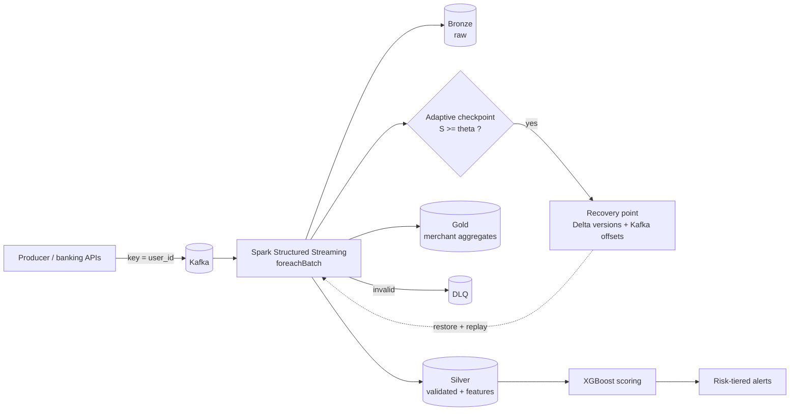

# StreamVault

A fault-tolerant, **versioned data lake** for financial-transaction analytics, with an
**adaptive checkpointing** policy compared against eager and lazy checkpointing.

Pipeline: **Kafka → Spark Structured Streaming → Delta Lake (Bronze/Silver/Gold) → XGBoost fraud scoring → risk-tiered alerts**,
with a dead-letter queue, Delta time-travel/rollback and recovery points that can replay Kafka.

Based on the paper *"A Fault-Tolerant Versioned Data Lake with Optimized Checkpointing for Financial Transactions"*
(Srivastava, Nistala, Samhitha, Khare; IEEE AIDML 2026).



## Adaptive checkpointing (paper Eq. 3-6)

Each micro-batch computes runtime metrics and a score

```
L = d / d_max     T = t_exec / t_max     M = mem% / 100
S = 0.40·L + 0.35·T + 0.25·M            checkpoint iff S >= 0.65
r = (k - k*) / N                        recovery ratio after a failure at stage k
```

`d` = micro-batches since the last recovery point, `t_exec` = batch duration, `m` = memory use.
A **recovery point** stores the Delta version of every table plus cumulative Kafka offsets. After a crash,
`--recover` restores each table with Delta `RESTORE` and replays Kafka from the stored offsets.
Spark's own checkpoint location still runs underneath for sink idempotence.

## Quick start

```bash
python -m venv .venv && source .venv/bin/activate
pip install -e ".[all]"        # needs Java 11/17/21 for Spark
make test                      # unit tests (no Docker, no Kafka)

# 1. unit-level experiments, no infrastructure
make bench && make plots       # eager vs lazy vs adaptive -> results/*.csv, *.png
make train                     # XGBoost on synthetic labelled data -> models/

# 2. full streaming pipeline
make infra-up                  # Kafka + MinIO via Docker
make stream                    # terminal 1 (Delta + Kafka jars are fetched by Spark on first run)
make produce                   # terminal 2
make score                     # fraud alerts from the Silver table
make versions                  # Delta history + snapshot metadata (Eq. 7)
python -m streamvault.streaming.pipeline --source kafka --recover   # after a crash

# no Docker? file-based source:
make demo-files
```

## Repository layout

| Path | What it does |
|---|---|
| `src/streamvault/checkpointing/` | Eq. 3-6 (`adaptive.py`) and eager / lazy / adaptive policies (`policies.py`) |
| `src/streamvault/streaming/` | Spark session, Bronze/Silver/Gold transforms, recovery-point manager, pipeline |
| `src/streamvault/storage/versioning.py` | Snapshot metadata `v_n`, time travel, rollback (Eq. 7, Alg. 3) |
| `src/streamvault/recovery/` | Restore + Kafka replay offsets; DLQ replay |
| `src/streamvault/ml/` | Features (Eq. 2), XGBoost training, risk tiers (Eq. 10-11), scoring |
| `src/streamvault/ingestion/producer.py` | Kafka producer (partition key `user_id`) with malformed-record injection |
| `src/streamvault/data/synthetic.py` | Labelled synthetic transactions |
| `benchmarks/` | Failure-injection benchmark + plots |
| `tests/` | 35 tests: policies, equations, transforms (local Spark), recovery manager, model |

## Benchmark method

`benchmarks/checkpoint_benchmark.py` runs a 12-stage Spark pipeline (every third stage shuffles) over 100K / 500K / 1M rows.
Stage outputs are cached (volatile); a checkpoint writes Parquet and re-reads it (durable). A failure at the last stage is
simulated by dropping all caches and recomputing from the last checkpoint. It reports pipeline time, throughput, number of
checkpoints, checkpoint storage and recovery latency. Absolute numbers depend on your machine; use `--repeats 3`.

## Status and limitations

- Unit tests, the transforms (on local Spark) and the checkpoint benchmark are exercised in CI/locally.
  The full **Kafka + Delta** path (`pipeline.py`, `recover.py`, `versioning.py`, `dlq.py`, `score.py`) needs Docker and
  network access to Maven for the Spark connector jars; run it locally before demoing.
- Fraud experiments use **synthetic** labelled data. Public transaction-*categorisation* datasets do not carry fraud labels.
- The paper does not define `t_max`, `d_max` or the memory source; here `t_max` is the running maximum, `d_max` is configurable
  (`config/config.yaml`) and memory is system memory from `psutil`.
- Prometheus metrics are exposed (`monitoring.prometheus_port`); Grafana dashboards are not included.
- Single-node setup; multi-executor scaling is controlled with `--master local[N]` / `spark.master`.

See `docs/PAPER_VS_CODE.md` for an equation-by-equation mapping.

## License

MIT
